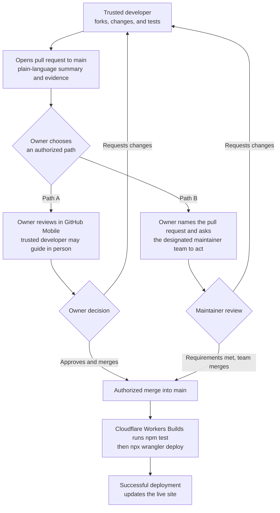

# Alam Al Mafrooshat Website

## Project summary

This is the source-managed multilingual website for Alam Al Mafrooshat, a family-run home-textile store in Erbil. It uses Vinext and React, has no CMS or database, and deploys as a Cloudflare Worker-compatible site.

## Commands

- `npm run dev` — start the local site.
- `npm run build` — create the production build.
- `npm test` — build and verify the rendered page and required assets.
- `npm run lint` — lint maintained source while excluding generated output.

## Architecture

- `app/page.tsx` contains the one-page site, all Arabic/Kurdish/English copy, the language switcher, and external contact links.
- `app/globals.css` contains all visual and responsive styling.
- `app/layout.tsx` owns site metadata, icons, and social-preview settings.
- `public/brand/` contains the production logo.
- `public/media/` contains the curated storefront images and videos.
- `wrangler.jsonc` defines the Cloudflare Worker and static-asset deployment.
- `docs/operations.md` is the durable deployment, domain, rollback, and troubleshooting reference.

## Third-party developer handoff

- External developers must work in their own fork and branch, then submit a pull request targeting `main`. They must never commit or merge directly to `main`.
- Never share GitHub passwords, access tokens, repository secrets, or other credentials with a developer.
- Before review, the developer must explain the change in plain language and show how it was verified, including relevant screenshots.
- After the pull request is opened, use one of these authorized paths:
  - **Path A — owner review:** The owner uses their own GitHub account in GitHub Mobile to review, approve, and, if desired, merge the pull request. A personally trusted developer may be physically present to guide them, but must not operate the account or merge the pull request.
  - **Path B — maintainer review:** The owner contacts the designated trusted technical support or maintainer team and explicitly asks them to use their own authorized accounts to review and merge the named pull request on the owner's behalf.
- Only an authorized merge into `main` starts the production deployment path. Cloudflare Workers Builds then runs `npm test` followed by `npx wrangler deploy`; after both succeed, the live site is updated. External developers cannot trigger deployment or bypass either approval path.
- The owner should act only on requests from a developer they personally trust. Never reveal passwords, one-time codes, recovery codes, or transfer control of the account.

## Conventions

- Arabic is the default language. Arabic and Kurdish use right-to-left layout; English uses left-to-right layout.
- Update all three language objects together when changing visible copy.
- Keep page content in source. Do not add a CMS, database, or runtime content API unless the product requirements genuinely change.
- Use normalized, descriptive filenames for new production media under `public/media/`. Preserve the original source assets in `Images/` and `Video/`.
- Keep Instagram, map, and other external destinations in constants near the top of `app/page.tsx`.
- Do not edit generated output under `dist/`.
- Production is `https://alam-al-mafrooshat.com`; pushes to `main` deploy through Cloudflare Workers Builds with no GitHub Actions workflow.
